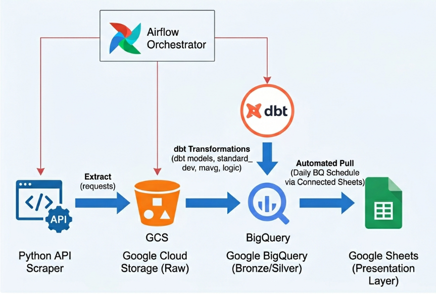
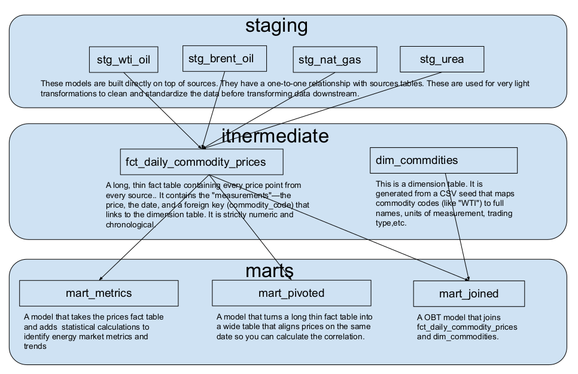

# Fuel and fertilizers Market Analysis

### 📊 Project Overview and Goal
This project is an automated **ELT** pipeline that offers a constant flow of real-time data to monitor global energy and commodities market. It tracks daily prices for commodities such as WTI Crude Oil, Brent Crude Oil, Natural Gas, and Urea (fertilizer) calculating real-time volatility, correlations, and market trends.
It moves beyond simple price tracking and provides **actionable market intelligence**. By applying statistical transformations to raw price data, this pipeline identifies:
1.  **7-Day & 30-Day Volatility:** to measure market uncertainty.
2.  **7-Day & 30-Day Moving Average:** to define trend signals ("Bullish" vs. "Bearish") by using Moving Average crossovers.
3.  **Cross-Commodity Correlation:** to find out if energy price movements impact global fertilizers production.

The Data Source: Integrating with the [Oil Price API](https://www.oilpriceapi.com/) for consistent, automated data fetching.

---

### 🗺️ Data Flow Diagram
Unlike traditional ETL, this project follows an **ELT (Extract, Load, Transform)** pattern: 
*   **Extract & Load:** Raw data is moved into BigQuery with minimal overhead, preserving the "Source of Truth."
*   **Transform:** Leveraging BigQuery's massive compute power to perform data modeling and complex transformations using **dbt**. First data is moved into staging area where models are created just to reflect the source tables with minor transformations (clean and standardize the data before transforming data downstream). Then data flows into the 'marts' area where more complex transformation are performed such as unions, joins, aggregations, deduplication, complex statistical calculations like moving average and standard deviation. This heavy lifting is deliberately done in **dbt**, so that the dashboard only has to "visualize" simple columns. Doing all this with **dbt** also ensures that transformation logic is version-controlled and tested.
Finally, the data is automatically pulled from analytics-ready marts into a Google sheet on a daily basis, to ensure the dashboard remains current without manual intervention.
Below is the visual representation of how data flows through the pipeline:

#### 🏗️ Technology Stack
| Layer | Technology | Purpose |
| :--- | :--- | :--- |
| **Orchestration** | **Apache Airflow** | Apache Airflow manages and triggers the sequential tasks from the Python API Scraper, moving the data into GCS, loading it into BigQuery, and executing the dbt transformations. |
| **Extraction** | **Python (Requests)** | Making scheduled requests to [Oil Price API](https://www.oilpriceapi.com/) and handling rate limits. |
| **Data Lake** | **Google Cloud Storage** | Landing zone for raw JSON/CSV data (Bronze Layer). |
| **Data Warehouse** | **BigQuery** | Serves as the central high-performance data warehouse and compute engine required to host the Medallion architecture, handling everything from raw data landing to the execution of intensive mathematical dbt models. |
| **Transformation** | **dbt (data build tool)** | Transforming raw data into analytics-ready marts using complex SQL window functions, implementing different types of materializations (view, incremental table), running tests, and generating documentation. |
| **Presentation** | **Google Sheets** | Google Sheets is a great tool for statistical deep-dives and interactive visualizations. It's not just free, completely customizable, and great for collaboration, but also enables automatic data refreshes ensuring the BI dashboard remains "live" without manual copying and pasting.|

Note: *This project is implemented using a triggered micro-batching architecture to simulate "real-time" data flow and also to demonstrate DAG orchestration. But I should mention that I understand that BigQuery is optimized for bulk loading from GCS rather than fetching individual entries for each API call and inserting them into tables. For high-volume production data, a daily bulk load would be more cost-effective and respect BigQuery's load job quotas.*

Note 2: *Since the primary goal of this project is to show my data engineering skills, I decided to use Google Sheets for the final presentation layer instead of a professional and advanced BI tool like Tableau or Power BI, to demonstrate that complex BI platforms are not always required to create a simple yet engaging interactive dashboard.*

---

### 📐 Data Organizational Framework and Modeling Strategy
This project utilizes a **Medallion-style architecture** , to provide a structured, multi-level pipeline to refine data, moving it through three main stages:

1.  **Staging (`stg_`)**: tables built directly on top of sources, used for very light transformations: changing raw types, renaming columns, discarding unnecessary columns, performing deduplication;
2.  **Intermediate (`fct_, dim_`)**: Combining (using union) staging tables into a "long and thin" fact table containing clean, historical price points for all commodities using incremental materialization technique.
3.  **Marts (`mart_`)**: Here, different tables are created based on the business needs ready for presentation: adding statistical transformations to the fact table to identify energy market metrics and trends, pivoting the fact table into a wide table that aligns prices on the same date (to identify correlations), joining the fact table with the dimension table to provide more description for commodities.
It also utilizes a combination of dimensional and OBT data modeling techniques

And while the data is moving through this multi-level it undergoes thorough testing. This process ensures integrity of the data, and that it is reliable, safe, and free from defects before it hits the dashboard. 

---

### 🧠 Acquired and Improved Skills 
- working with GCP tools such as Compute Engine, Cloud Storage and BigQuery, managing data across multiple cloud environments;
- launching and working with Airflow to create an automated ELT data pipeline, 
- installing and working with dbt to enable in-warehouse data transformation, testing, and documentation, Ability to implement different materialization techniques, specifically incremental;
- implementing data modeling strategies such as star schema and OBT, organizing data into multiple stages, or layers (Medallion-style architecture)
- Applying statistical concepts (Standard Deviation, Moving Average, Lags) to time-series data;

